# Alt-Data Pipeline: Automated Tech & SaaS Signal Feed

[](https://github.com/Rachit2407/alt-data-pipeline/actions/workflows/ci.yml)
[](https://github.com/Rachit2407/alt-data-pipeline/actions/workflows/daily_ingest.yml)
[](LICENSE)
[](https://www.python.org/downloads/)
[](https://duckdb.org/)
[](https://parquet.apache.org/)

A compliance-first **Point-in-Time (PIT)** alternative data pipeline built in Python, Pydantic, `httpx`, DuckDB, and Parquet.

It tracks three public, unauthenticated signal streams across major tech and SaaS companies:
1. **Public ATS Job Board Feeds (Greenhouse & Lever JSON)** — Engineering hiring velocity, AI/ML vs. GTM role mix, and role open/closure lifecycles.
2. **Public SaaS Pricing Pages (`/pricing`)** — Seat price increases, usage-tier shifts, free-tier modifications, and enterprise gating.
3. **Public Developer Changelog & Release Feeds (RSS 2.0 / Atom)** — Product shipping cadence and correlation with engineering expansion.

---

## Architecture & Data Flow

```mermaid
flowchart TD
    subgraph PublicSources ["Public, Unauthenticated Sources"]
        ATS["Greenhouse / Lever JSON APIs"]
        Pricing["Public /pricing Marketing Pages"]
        Changelog["Public RSS / Atom Changelogs"]
    end

    subgraph ComplianceLayer ["Compliance & Politeness Guardrails"]
        Robots["robots.txt Parser & Cache (RFC 9309)"]
        RateLimit["Per-Domain Rate Limiter + Jitter + Crawl-delay"]
        Guardrails["Auth-Wall & Anti-Bot Detection (Zero Bypass)"]
    end

    subgraph RawArchive ["Raw Immutable Snapshots"]
        RawATS["data/raw/ats/YYYY-MM-DD/"]
        RawPricing["data/raw/pricing/YYYY-MM-DD/"]
        RawCL["data/raw/changelogs/YYYY-MM-DD/"]
    end

    subgraph SCD2Warehouse ["DuckDB PIT Warehouse (alt_data.duckdb)"]
        dim_entities["dim_entities"]
        fact_crawl_runs["fact_crawl_runs (Audit Trail)"]
        fact_jobs["fact_job_postings_pit (SCD Type 2)"]
        fact_pricing["fact_pricing_tiers_pit (SCD Type 2)"]
        fact_changelogs["fact_changelogs_pit (SCD Type 2)"]
        fact_diffs["fact_signal_diffs (Delta Engine)"]
    end

    subgraph DownstreamExports ["Downstream Datasets & Digests"]
        Parquet["data/exports/parquet/*.parquet"]
        CSV["data/exports/csv/*.csv"]
        DigestMD["data/exports/signal_digest.md"]
        DigestJSON["data/exports/signal_digest.json"]
    end

    PublicSources --> ComplianceLayer
    ComplianceLayer --> RawArchive
    RawArchive --> SCD2Warehouse
    SCD2Warehouse --> DownstreamExports
```



---

## Point-in-Time (PIT) Data Hygiene

Quantitative researchers and financial analysts cannot use datasets that suffer from **look-ahead bias** or **survivorship bias**. This pipeline enforces strict bitemporal data hygiene:

- **Immutable History:** Rows are never overwritten. When a job posting changes title or closes, or when a SaaS price changes, the previous version is closed (`valid_to_utc = observed_at, is_current = FALSE`), and a new version is appended (`valid_from_utc = observed_at, is_current = TRUE`).
- **Closed Tombstones:** When a job disappears from a successful full-board crawl, a tombstone row is inserted (`is_active = FALSE, closed_at_utc = observed_at`) so role duration can be accurately calculated.
- **As-Of Querying:** Any historical query using:
  ```sql
  WHERE valid_from_utc <= :as_of
    AND (valid_to_utc IS NULL OR valid_to_utc > :as_of)
  ```
  reconstructs the exact state of the world known at timestamp `:as_of` with **zero look-ahead bias**.

---

## Strict Compliance & Legal Grounding

1. **Strictly Public Ingestion:** Ingests only unauthenticated, public JSON endpoints and marketing pages. Zero login bypassing, zero credential scraping, zero CAPTCHA solving, and zero LinkedIn scraping.
2. **Fail-Closed `robots.txt` Enforcement:** Every request checks the origin host's `/robots.txt`. If disallowed or inaccessible (HTTP 401/403/5xx), requests fail closed and are recorded in `fact_crawl_runs`.
3. **Polite Crawling:** Enforces per-domain rate limits with random jitter, respects `Crawl-delay` directives, identifies the collector via a transparent `User-Agent`, and halts cleanly upon encountering auth redirects (`/login`) or anti-bot challenge headers.

---

## Directory Layout

```text
alt-data-pipeline/
├── .github/workflows/
│   ├── ci.yml                  # Automated pytest suite on push/PR
│   └── daily_ingest.yml        # Daily 06:00 UTC automated ingestion workflow
├── config/
│   └── entities.yaml           # Canonical entity registry (ATS, pricing, RSS mappings)
├── src/alt_data/
│   ├── compliance.py           # robots.txt parser, rate limiter, and compliance guardrails
│   ├── models.py               # Pydantic v2 schemas for all PIT events
│   ├── collectors/
│   │   ├── ats_jobs.py         # Greenhouse & Lever public JSON collectors
│   │   ├── pricing_pages.py    # Public pricing card parser (+ optional Playwright fallback)
│   │   └── changelogs.py       # Public RSS 2.0 / Atom changelog collector
│   ├── storage/
│   │   ├── duckdb_store.py     # DuckDB SCD Type 2 warehouse & Parquet/CSV exporter
│   │   └── diff_engine.py      # Automated diff detection & signal digest generator
│   └── cli.py                  # CLI commands (init-db, run-*, query-pit, export, report)
├── examples/
│   └── pit_analysis.py         # Downstream analytical script querying Parquet directly
├── data/                       # Local warehouse and exports (git-ignored)
│   ├── raw/                    # Immutable timestamped JSON, HTML, and XML files
│   ├── warehouse/              # alt_data.duckdb local analytical database
│   └── exports/                # Parquet, CSV, and Markdown signal digests
└── tests/
    ├── test_compliance.py      # robots.txt, domain blocklist, and rate-limiting tests
    ├── test_models.py          # Schema validation, ATS/RSS parsing, and pricing tests
    └── test_pit_scd2.py        # SCD Type 2 PIT lifecycle, zero look-ahead bias & exports
```

---

## Quickstart

```powershell
# 1. Clone and create virtual environment
git clone https://github.com/Rachit2407/alt-data-pipeline.git
cd alt-data-pipeline
python -m venv .venv
.venv\Scripts\Activate.ps1

# 2. Install dependencies (including test suite)
pip install -e ".[dev]"

# 3. Run unit & PIT integration tests
pytest -v

# 4. Initialize DuckDB warehouse schema and sync entity config
alt-data init-db

# 5. Ingest all 3 public signal feeds
alt-data run-ats
alt-data run-pricing
alt-data run-changelogs

# 6. Export Parquet / CSV datasets and generate PIT Signal Digest
alt-data export
alt-data report

# 7. Run downstream analytical script directly against Parquet files
python examples/pit_analysis.py

# 8. Launch the local interactive Point-in-Time web dashboard
alt-data dashboard
# Open http://127.0.0.1:8501 in your browser
```

---

## CLI Usage Reference

| Command | Description |
| :--- | :--- |
| `alt-data init-db` | Initializes DuckDB tables and synchronizes `config/entities.yaml`. |
| `alt-data run-ats [--entity ID]` | Ingests public Greenhouse/Lever job boards and detects `ROLE_OPENED`, `ROLE_CLOSED`, `ROLE_UPDATED`, and `HIRING_VELOCITY_SHIFT`. |
| `alt-data run-pricing [--entity ID] [--playwright]` | Ingests public pricing pages and detects `PRICE_CHANGE`, `TIER_ADDED`, and `TIER_REMOVED`. |
| `alt-data run-changelogs [--entity ID]` | Ingests public RSS/Atom changelog feeds and detects `CHANGELOG_PUBLISHED`. |
| `alt-data query-pit --as-of <ISO-8601> [--entity ID]` | Queries the exact active job and pricing state known at a past timestamp. |
| `alt-data export` | Exports all 6 warehouse tables to `data/exports/parquet/` and `data/exports/csv/`. |
| `alt-data report [--as-of <ISO-8601>]` | Generates a structured Markdown and JSON signal digest in `data/exports/`. |
| `alt-data dashboard [--port 8501]` | Launches the local interactive web dashboard with Point-in-Time date sliders and live charts. |

---

## SQL Point-in-Time Cookbook

You can query the exported Parquet tables directly using **DuckDB**, **Polars**, or **Pandas** without running any database server.

### 1. Point-in-Time Job Openings (Reconstructed at Timestamp `T`)
```sql
SELECT
    entity_id,
    COUNT(*) AS active_jobs,
    SUM(CASE WHEN role_family = 'engineering' THEN 1 ELSE 0 END) AS eng_count,
    SUM(CASE WHEN role_family = 'ai_ml' THEN 1 ELSE 0 END) AS ai_ml_count,
    ROUND(SUM(CASE WHEN role_family IN ('engineering', 'ai_ml', 'data', 'security') THEN 1.0 ELSE 0.0 END) / COUNT(*) * 100, 1) AS tech_pct
FROM read_parquet('data/exports/parquet/fact_job_postings_pit.parquet')
WHERE valid_from_utc <= '2026-11-01T00:00:00Z'
  AND (valid_to_utc IS NULL OR valid_to_utc > '2026-11-01T00:00:00Z')
  AND is_active = TRUE
GROUP BY entity_id
ORDER BY active_jobs DESC;
```

### 2. Track SaaS Price Changes Over Time
```sql
SELECT
    entity_id,
    signal_type,
    external_ref,
    old_value AS previous_price,
    new_value AS new_price,
    pct_delta,
    detected_at_utc
FROM read_parquet('data/exports/parquet/fact_signal_diffs.parquet')
WHERE signal_type = 'PRICE_CHANGE'
ORDER BY detected_at_utc DESC;
```

### 3. Correlate Product Shipping Velocity vs. Engineering Headcount
```sql
WITH eng_headcount AS (
    SELECT entity_id, COUNT(*) AS active_eng_roles
    FROM read_parquet('data/exports/parquet/fact_job_postings_pit.parquet')
    WHERE is_active = TRUE AND role_family IN ('engineering', 'ai_ml')
    GROUP BY entity_id
),
releases_30d AS (
    SELECT entity_id, COUNT(*) AS release_count
    FROM read_parquet('data/exports/parquet/fact_changelogs_pit.parquet')
    WHERE published_at_utc >= CURRENT_TIMESTAMP - INTERVAL 30 DAY
    GROUP BY entity_id
)
SELECT
    COALESCE(e.entity_id, r.entity_id) AS entity_id,
    COALESCE(e.active_eng_roles, 0) AS active_eng_roles,
    COALESCE(r.release_count, 0) AS releases_last_30d
FROM eng_headcount e
FULL OUTER JOIN releases_30d r ON e.entity_id = r.entity_id
ORDER BY releases_last_30d DESC;
```

---

## Sample Output (`signal_digest.md`)

```markdown
# Alternative Data Signal Digest
Snapshot Date: 2026-11-12T18:19:20Z

## 1. Hiring Velocity & Technical Role Mix
| Entity      | Active Roles | Engineering | AI / ML | Data | Security | GTM | Tech Share % |
|:------------|-------------:|------------:|--------:|-----:|---------:|----:|-------------:|
| stripe      |          782 |         259 |      33 |   14 |       27 | 210 |        42.6% |
| anthropic   |          676 |         129 |     168 |   13 |      100 | 124 |        60.7% |
| cloudflare  |          480 |         208 |      12 |   10 |       25 | 163 |        53.1% |
| datadog     |          392 |          99 |      18 |    1 |       15 | 171 |        33.9% |
| figma       |          142 |          30 |      16 |    1 |        3 |  60 |        35.2% |
| vercel      |           87 |          30 |       2 |    1 |        6 |  26 |        44.8% |
| wealthfront |           22 |           6 |       1 |    2 |        0 |   2 |        40.9% |

## 2. Product Release Velocity (Last 30 Days PIT)
| Entity      | Releases (30d) | Total Tracked | Latest Release (UTC) |
|:------------|---------------:|--------------:|:---------------------|
| cloudflare  |            137 |          1491 | 2026-11-12 00:00:00  |
| vercel      |            100 |           100 | 2026-11-11 00:00:00  |
| datadog     |             39 |            97 | 2026-11-11 00:00:00  |
| supabase    |             18 |           448 | 2026-11-10 07:00:00  |
| posthog     |             12 |           266 | 2026-11-12 00:00:00  |
```

---

## License

This project is licensed under the MIT License — see the [LICENSE](LICENSE) file for details.
